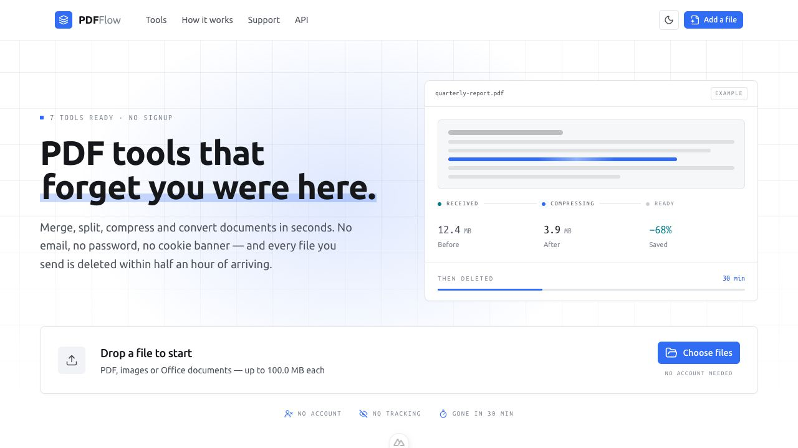

<div align="center">


# PDFFlow

**Fast, private PDF tools that forget you were here. Merge, split, compress, organize and convert documents with no account, no tracking, and no permanent storage.**

[](https://github.com/RithyBondeth/PDFFlow/actions/workflows/ci.yml)


</div>

---



## Overview

Most online document tools ask for an account, track how you use them, or leave you wondering where your files went. PDFFlow keeps a simpler promise: **upload a document, do the job, download the result, and leave no footprint.**

There are no accounts, session cookies, analytics, or advertising trackers. Uploaded files are stored under generated names in temporary storage. Inputs are deleted as soon as processing ends, and results expire within 30 minutes.

## Features

| Tool | What it does | Output |
| --- | --- | --- |
| **Merge PDF** | Combine multiple PDFs in drag-and-drop order | PDF |
| **Split PDF** | Split every page, or use explicit page ranges | ZIP |
| **Extract Pages** | Build a new document from selected pages | PDF |
| **Rotate PDF** | Rotate the whole document or selected pages | PDF |
| **Organize Pages** | Reorder, rotate, duplicate and remove pages visually | PDF |
| **Compress PDF** | Choose a compression level and compare file sizes | PDF |
| **Office to PDF** | Convert DOCX, XLSX and PPTX with LibreOffice | PDF |
| **Images to PDF** | Turn JPG, PNG and WEBP images into one PDF | PDF |
| **PDF to Images** | Render pages as PNG, JPEG or WEBP at 72, 150 or 300 DPI | ZIP |
| **Protect PDF** | Encrypt with AES-256 and optionally restrict printing or copying | PDF |
| **Unlock PDF** | Remove protection with the document's password | PDF |
| **Watermark PDF** | Stamp text or a logo, centered or tiled, with a live preview | PDF |
| **Extract Images** | Pull out every embedded image, with JPEGs untouched and transparency kept | ZIP |

Also included:

- **Live progress** over Server-Sent Events.
- **A public REST API,** with no keys or accounts needed.
- **Responsive UI** with light and dark themes.
- **Uploads treated as hostile:** content signatures, extensions and size limits are checked while the file streams in.
- **Rate limiting** and safe error envelopes that include request IDs.

## Tech Stack

| Area | Technology |
| --- | --- |
| Frontend | Nuxt 4, Vue 3, TypeScript, Tailwind CSS 4, Nuxt UI, Pinia |
| API | FastAPI, Pydantic v2, SQLAlchemy 2, Alembic |
| Processing | Celery 5, PyMuPDF, pypdf, Pillow, LibreOffice |
| Data and events | PostgreSQL 16, Redis 7 |
| Infrastructure | Docker Compose, Nginx, Railway |
| Testing | Pytest, Vitest, GitHub Actions |

## Architecture

```text
┌──────────────┐       ┌──────────────┐       ┌──────────────┐
│ User browser │──────►│    Nginx     │──────►│    Nuxt 4    │
└──────────────┘ HTTPS │ rate limiting│       │   frontend   │
                       └──────┬───────┘       └──────────────┘
                              │ /api
                       ┌──────▼───────┐
                       │   FastAPI    │
                       └───┬──────┬───┘
                           │      │
                  ┌────────▼─┐  ┌─▼──────────┐
                  │PostgreSQL│  │   Redis    │
                  │ metadata │  │queue+pubsub│
                  └──────────┘  └─────┬──────┘
                                      │
                                ┌─────▼──────┐
                                │   Celery   │
                                │   worker   │
                                └─────┬──────┘
                                      │
                                ┌─────▼──────┐
                                │ temporary  │
                                │  storage   │
                                └────────────┘
```

Redis is both the Celery broker and the pub/sub channel for live progress, so API replicas can scale horizontally. See [architecture.md](docs/architecture.md) and the [security model](docs/security.md).

## Getting Started

### Prerequisites

- [Docker](https://docs.docker.com/get-docker/) with Compose

### Installation

```bash
git clone https://github.com/RithyBondeth/PDFFlow.git
cd PDFFlow
cp .env.example .env
docker compose up --build
```

Open [http://localhost:8080](http://localhost:8080). Interactive API docs are at [http://localhost:8080/docs](http://localhost:8080/docs).

<details>
<summary><strong>Run the services separately for development</strong></summary>

```bash
# Backend
cd backend
python -m venv .venv
.venv/bin/pip install -r requirements-dev.txt
.venv/bin/uvicorn app.main:app --reload

# Worker and scheduler (Redis and PostgreSQL must be running)
.venv/bin/celery -A app.worker.celery_app.celery_app worker --loglevel=info
.venv/bin/celery -A app.worker.celery_app.celery_app beat --loglevel=info

# Frontend
cd frontend
npm install
npm run dev
```

</details>

### Environment Variables

| Variable | Default | Purpose |
| --- | --- | --- |
| `HTTP_PORT` | `8080` | Public Nginx port |
| `MAX_UPLOAD_BYTES` | `104857600` | Per-file upload limit (100 MB) |
| `MAX_FILES_PER_JOB` | `25` | Files accepted by one job |
| `FILE_TTL_MINUTES` | `30` | Maximum result lifetime |
| `CLEANUP_INTERVAL_SECONDS` | `300` | Expired-file sweep interval |
| `CORS_ORIGINS` | Localhost | Allowed browser origins |
| `TRUSTED_PROXIES` | Private networks | Proxies allowed to set forwarding headers |

### Testing

```bash
cd backend && .venv/bin/pytest
cd frontend && npm test && npm run typecheck && npm run build
```

## API

| Method | Endpoint | Purpose |
| --- | --- | --- |
| `GET` | `/api/operations` | Discover the available tools and their file requirements |
| `POST` | `/api/upload` | Upload one or more validated files |
| `POST` | `/api/jobs/create` | Queue an operation |
| `GET` | `/api/jobs/{id}/events` | Follow progress over Server-Sent Events |
| `GET` | `/api/jobs/{id}/status` | Poll the job status |
| `GET` | `/api/download/{id}` | Download the completed result |
| `GET` | `/api/health` | Check API, PostgreSQL and Redis health |

Swagger UI is at `/docs`, ReDoc at `/redoc`, and the OpenAPI schema at `/openapi.json`.

## Project Structure

```text
PDFFlow/
├── frontend/                  # Nuxt application and server proxy
├── backend/
│   ├── app/api/routes/        # Health, uploads, jobs, downloads
│   ├── app/services/          # Validation, storage, events, rate limiting
│   ├── app/worker/            # Celery tasks and document operations
│   └── tests/
├── database/migrations/       # Alembic migrations
├── infrastructure/            # Production Compose and Nginx configuration
├── docs/                      # Architecture, security, deployment guides
└── compose.yaml               # Local full-stack entry point
```

## Deployment

- **Railway:** follow the [Railway deployment guide](docs/railway.md).
- **Docker host:** combine the development and production Compose files, as described in [`infrastructure/docker-compose.prod.yml`](infrastructure/docker-compose.prod.yml).
- **TLS:** the production Nginx configuration supports Let's Encrypt through the included Certbot services.

In production, set a strong PostgreSQL password, use the exact public origin for CORS, narrow the trusted proxy ranges, and run **exactly one** Celery beat replica.

## Contributing

Contributions, bug reports, and feature ideas are welcome. Fork the repository, create a focused branch, add tests, and open a pull request. For larger changes, [open an issue](https://github.com/RithyBondeth/PDFFlow/issues/new) first.

If PDFFlow is useful to you, please [⭐ star the repository](https://github.com/RithyBondeth/PDFFlow).

## Author

**Rithy Bondeth** — Full Stack Developer & AI Engineer

[](https://bondeth.dev)
[](https://github.com/RithyBondeth)
[](https://www.linkedin.com/in/rithy-bondeth-484073282/)

## License

Distributed under the MIT License. See [`LICENSE`](LICENSE) for details.
